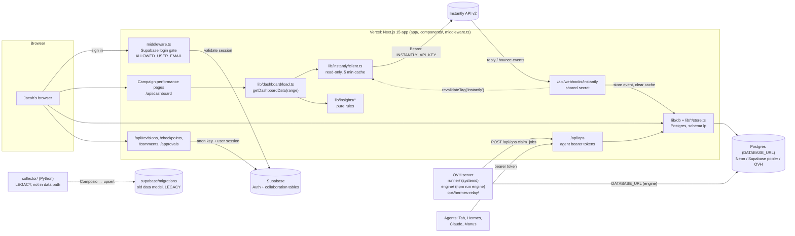

# Architecture

## 1. Purpose

A private marketing dashboard for Instantly cold-email campaigns: live, honest numbers for any date
range, plus a Postgres "lead platform" (schema `lp`) for leads, verification, campaigns, tasks, and
agent work. Next.js 15 on Vercel, with a few zero-dependency Node services on an OVH server for
long-running jobs. This document is the map: what each piece is, what it talks to, and where to look
when something breaks. Keep it current with `docs/` (see §8).

## 2. Data flow

Read it as three paths:

- **Live numbers (solid, top):** browser → `/api/dashboard` or the performance page → `lib/dashboard/load.ts`
  → `lib/instantly/client.ts` → Instantly. Nothing is stored; every number is recomputed from Instantly
  responses. A `null` means Instantly did not say; `0` is a measured zero (see AGENTS.md).
- **Lead platform (middle):** pages and agents read and write Postgres schema `lp` through `lib/db`
  (`DATABASE_URL`). Agents go through `/api/ops`, never straight to the database.
- **Login and collaboration (Supabase):** the login gate validates a Supabase session cookie. The
  collaboration routes also read and write Supabase tables (see flag F1 in §7).
- **Legacy (dotted):** `collector/` and `supabase/migrations/` are the old Composio → Supabase
  pipeline. The dashboard does not read them.

## 3. Directory map

| Path | What lives there | Key entry points |
|---|---|---|
| `app/` | Next.js App Router: 41 pages and 41 route handlers | `layout.tsx`, `page.tsx` (Overview), `api/dashboard/route.ts`, `api/ops/[[...path]]/route.ts`, `api/webhooks/instantly/route.ts` |
| `app/actions/` | Server actions called by forms (`'use server'`) | `campaigns.ts`, `settings.ts`, `ops.ts`, `seo.ts` |
| `app/api/` | HTTP routes, grouped by feature | `ops/` (agents), `webhooks/` (Instantly), `verify/`, `find/`, `leads/`, `reports/`, `rules/` |
| `components/` | Client and shared UI, grouped by page | `nav/AppNav.tsx`, `dashboard/Dashboard.tsx`, `leads/`, `campaigns/`, `settings/` |
| `middleware.ts` | Login gate. Fails closed. Passes `/api/ops` and `/api/webhooks` to their own auth | `isSelfAuthenticatingApi`, `devAuthBypassEnabled` |
| `lib/` | Server-side logic, one folder per feature, 27 folders | see below |
| `lib/instantly/` | Read-only Instantly v2 client (retries, pagination, cache) | `client.ts`, `endpoints.ts`, `writer.ts` (approval-gated writes) |
| `lib/dashboard/` | Campaign performance: date ranges, metrics, staged loading | `load.ts` (`getDashboardData`), `types.ts` (the contract) |
| `lib/insights/` | Pure "what to do next" rules. No I/O. | `index.ts` (`computeInsights`), `thresholds.ts`, `docs/INSIGHTS.md` |
| `lib/db/` | Postgres access for `lp` (pg pool, `getDb()` returns null when unset) | `index.ts`, `pg.ts` |
| `lib/ops/` | Ops API: auth, gate, pause, dispatch of ops | `gate.ts`, `auth.ts`, `dispatch.ts` |
| `lib/campaigns/`, `lib/campaign-steps/`, `lib/campaign-profiles/` | Campaign objects, email steps, per-campaign profiles | `store.ts`, `evaluator.ts` |
| `lib/leads/`, `lib/rules/`, `lib/verify/`, `lib/suppressions/` | Lead CRUD and import, lead rules, paid verification, suppression list | `leads/import.ts`, `rules/evaluate.ts`, `verify/waterfall.ts` |
| `lib/seo/` | SEO audits, AI-answer visibility checks, WordPress and Search Console | `audit.ts`, `visibility.ts`, `wordpress.ts` |
| `lib/reports/`, `lib/export/` | Runway, cost per meeting, weekly one-pager, Lead Master export to Sheets | `reports/load.ts`, `export/sheets.ts` |
| `lib/jobs/`, `lib/engine/` | Job definitions and cron, runner status, engine job queue | `jobs/store.ts`, `lib/engine/jobs.ts` |
| `lib/settings/`, `lib/integrations/`, `lib/notify/` | Encrypted settings, tools hub integrations, notifications and quiet hours | `settings/crypto.ts`, `settings/registry.ts`, `notify/deliver.ts` |
| `lib/webhooks/` | Parsing and storing Instantly webhook events | `instantly.ts` |
| `lib/supabase.ts`, `lib/request-client.ts`, `lib/revisions.ts` | Supabase browser client, request-scoped client, revision history | used by login and the collaboration routes (flag F1) |
| `engine/` | Lead engine: find, crawl, enrich, build leads. Long jobs run on the OVH server. | `cli.ts` (`npm run engine`), `findLeads.ts`, `worker.ts` |
| `runner/` | Background job runner, zero npm dependencies | `index.mjs` (poll loop), `lib.mjs`, `handlers/*.mjs` (one file per job kind) |
| `ops/` | Deployment units and env templates for OVH services | `ops/runner/tapdash-runner.service`, `ops/hermes-relay/relay.mjs` |
| `db/` | **Active** schema for `lp`: `db/migrations/`, 28 files, applied by `scripts/db-migrate.mjs` | `db/migrations/0001_lead_platform.sql` through `0023_env_secret_seen.sql` |
| `supabase/` | **Legacy** Supabase data model in `supabase/migrations/`. Kept for reference; the collaboration routes depend on the tables from 008 and 009. | `supabase/migrations/008_collaboration_store.sql` |
| `.github/` | CI and the docs bot | `.github/workflows/ci.yml`, `.github/workflows/docs-maintainer.yml` |
| `collector/` | **Legacy** Python collector (Composio → Supabase). Not in the data path. | `run_v2.py`, `collect_instantly.py` |
| `scripts/` | One-off and deploy scripts | `db-migrate.mjs`, `import-lead-master.ts`, `push-lead-master.ts`, `export-lead-master.ts`, `check-docs.mjs` |
| `tests/` | Vitest suites (124 files), fixtures, and fakes for Instantly, Postgres (PGlite) and web | `tests/helpers/`, `tests/fixtures/instantly/` |
| `docs/` | Feature notes, runbooks, reviews, and this file | `ARCHITECTURE.md`, `AGENTS_API.md`, `LEAD_PLATFORM.md` |
| `.github/workflows/` | CI (`ci.yml`) and the post-merge docs bot (`docs-maintainer.yml`) | see §6 |
| `AGENTS.md` | House rules for every agent working here. Binding. | — |
| Root config | Build, lint, test, and deploy settings | `package.json`, `next.config.ts`, `vercel.json` (`buildCommand: npm run vercel-build`), `vitest.config.mts`, `tailwind.config.ts`, `.env.example` |

## 4. Key contracts

- `lib/dashboard/types.ts`: `DashboardData`, `Counts`, `Rates`, `CampaignRow`. Every rendered number
  is typed here. `null` means "not reported".
- `lib/instantly/client.ts`: the only way the app calls Instantly. Read-only by construction; POST is
  allowed only for endpoints in `READ_ONLY_POSTS`.
- `lib/instantly/writer.ts` and `lib/instantly/gate.ts`: the only writes to Instantly (add leads,
  pause, resume). Behind the `INSTANTLY_ACTIONS` flag and a confirm click.
- `middleware.ts`: the login gate. Every route is gated except `/login`, `/api/auth/*`, and the
  self-authenticating `/api/ops/*` and `/api/webhooks/*`.
- `lib/ops/auth.ts`: agent identity. `OPS_AGENT_TOKENS` maps each agent to its bearer token.
- `lib/db/index.ts`: `getDb()` returns `null` when `DATABASE_URL` is unset. Pages show "Setup needed".
- `db/migrations/*.sql`: the `lp` schema. Applied in filename order, each file once, recorded in
  `lp_schema_migrations`.
- `runner/handlers/*.mjs`: each file exports `{ kind, handle(ctx) }`. Adding a job kind means adding
  one file.
- `AGENTS.md` data rules: `NULL` is never coerced to `0`. Rates are recomputed from counts, never
  averaged. Figures must come from a stored row or a named API response.

## 5. Commands (from `package.json`)

| Command | What it does |
|---|---|
| `npm run dev` | Next dev server. Add `DASHBOARD_DEV_NO_AUTH=1` to skip login locally. |
| `npm run build` | Production build. CI runs it with no secrets. |
| `npm run vercel-build` | Migrations (`db-migrate --on-build`), then `next build`. This is what Vercel runs. |
| `npm run check` | Typecheck, lint, and tests. Run before every PR. |
| `npm run typecheck` / `lint` / `lint:strict` / `test` | The individual parts of `check` (`lint:strict` allows zero warnings). |
| `npm run db:migrate` | Apply pending `db/migrations` to `DATABASE_URL` (`--status` lists them). |
| `npm run engine -- …` | Lead engine: `worker`, `run`, `status`. Run on the OVH server. |
| `npm run import:lead-master` / `push:lead-master` / `export:lead-master` | Lead Master Sheet import, load, and read-only export. |
| `npm run docs:check` | Deterministic docs check (`scripts/check-docs.mjs`). Runs in CI. |

## 6. Automation

- **CI** (`.github/workflows/ci.yml`): on every PR and push to `main`. Typecheck, lint, test, docs
  check, build. No secrets.
- **Docs bot** (`.github/workflows/docs-maintainer.yml`): after every change lands on `main`. It runs
  Claude Code to verify docs against the code, refresh this file, and report orphans and
  contradictions. It opens a docs PR only when it changes something, and comments on the source PR.
  It needs the repository secret `ANTHROPIC_API_KEY` (or `CLAUDE_CODE_OAUTH_TOKEN`). See flag F2.
- **Runner** (`ops/runner`, systemd on OVH): polls `/api/ops` for due jobs every 15 s and runs them.
- **Hermes relay** (`ops/hermes-relay`, systemd on OVH): wakes Hermes when a task is assigned to it.
- **Vercel cron**: `CRON_SECRET` lets Vercel Cron call `/api/ops/export/lead-master`.

## 7. Known mismatches (verified in code; open until fixed)

- **F1. Supabase is not only login.** README and AGENTS.md say Supabase is login only. The code also
  uses it for data: `app/api/revisions`, `checkpoints`, `comments`, and `approvals` query Supabase
  tables through `lib/request-client.ts`, and `lib/revisions.ts` upserts into `revisions`. Owner:
  `@build-data`. Evidence: `grep -rn "from('" app/api lib/revisions.ts`.
- **F2. The docs bot cannot run yet.** Run 38163605226 failed in step "Audit docs with Claude" with
  `Either ANTHROPIC_API_KEY, CLAUDE_CODE_OAUTH_TOKEN, or workload identity federation ... is required`.
  The repository secret is missing. Runs 12–15 also concluded `failure`; only run 15's log was read,
  so the others are unconfirmed. Owner: `@leaddesk`.
- **F3. `docs/RUNNER.md` says the runner is "NOT DEPLOYED"**, but `runner/` and `ops/runner/` exist.
  The status line may be stale. Verify with the OVH host and update it.
- **F4. Collector status is unclear.** Root README says the collector "can be switched off once the new
  version is live". `collector/README.md` describes it as running on the OVH VM and points at an open
  card (T4). Confirm whether it is still running.

## 8. How this stays current

1. Every PR runs `npm run check`, which includes `docs:check`. That check verifies the deterministic
   facts: relative links resolve, `npm run` names exist, backticked repo paths exist, and every
   top-level directory appears in §3.
2. After each change lands on `main`, the docs bot re-verifies the docs and updates this file (§8
   "Last verified" below).
3. Owners fix flags in §7 and remove them when they are closed.

Last verified: commit `9556674` (the working branch's HEAD when this file was written).

## 9. When something is not working

| Symptom | Look at first |
|---|---|
| Numbers missing or "not connected" | `INSTANTLY_API_KEY` set? `/api/dashboard` `errors[]` names the failing source. `lib/instantly/client.ts`. |
| Every page redirects to `/login` | `NEXT_PUBLIC_SUPABASE_*` and `ALLOWED_USER_EMAIL`. `middleware.ts` fails closed on purpose. |
| Lead screens say "Setup needed" | `DATABASE_URL` unset, or migrations not applied. `npm run db:migrate -- --status`. |
| Build fails on Vercel with a migration error | `scripts/db-migrate.mjs`. A failed migration fails the deploy on purpose. |
| Agent gets 401 or 423 | `OPS_AGENT_TOKENS` for that agent, and whether the agent is paused (`lib/ops/pause.ts`). |
| Instantly webhook events not stored | `INSTANTLY_WEBHOOK_SECRET` must match Instantly's header. `app/api/webhooks/instantly/route.ts`. |
| Job never runs | Runner logs on OVH, `RUNNER_KEY`, `jobs.schedule_cron`, and `lib/jobs/runner-status.ts`. |
| Docs bot did not comment or open a PR | Its workflow run log (see F2). |

## 10. Documentation index

| Doc | Covers |
|---|---|
| `README.md` | Overview, how the dashboard works, environment variables |
| `AGENTS.md` | House rules for agents (binding) |
| `docs/ARCHITECTURE.md` | This file |
| `docs/LEAD_PLATFORM.md` | The `lp` database, ops API, Lead Master import |
| `docs/AGENTS_API.md` | How an agent works with the ops API |
| `docs/DATA_MODEL_V2.md` | Data model spec (marked "not implemented") |
| `docs/INSIGHTS.md` | Every insight rule, threshold, and formula |
| `docs/campaigns.md`, `docs/campaign-profiles.md`, `docs/EVALUATOR_INTERFACE.md` | Campaigns workspace, profiles, lead-rule evaluator |
| `docs/lead-rules.md`, `docs/lead-engine.md` | Lead rules; the lead engine (Find leads) |
| `docs/phase2.md` | Reports and Instantly action buttons |
| `docs/seo.md` | `/seo` section |
| `docs/PAGE_COMMENTS.md`, `docs/COPY_DECK.md` | Page comments; dashboard states and copy |
| `docs/RUNNER.md`, `docs/RUNNER-integrations.md` | Background runner and its handlers |
| `docs/agent-delivery.md` | Agent delivery readiness |
| `docs/followup-safety-2026-10-09.md`, `docs/platform-review-2026-10-09.md` | Dated reviews. Snapshots, not current state. |
| `collector/README.md`, `ops/hermes-relay/README.md` | Legacy collector; Hermes relay |
