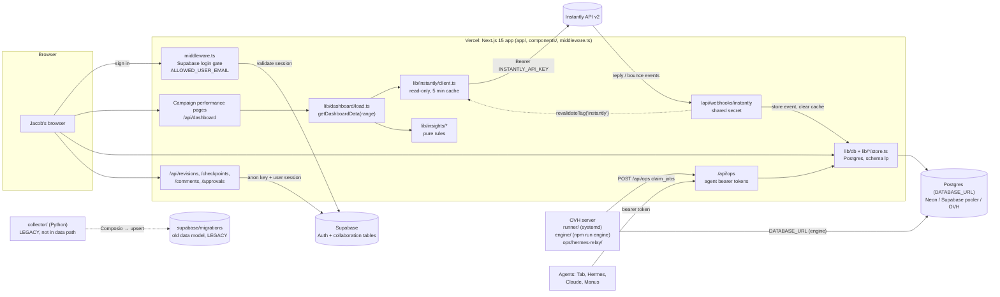

# Architecture

## 1. Purpose

A private marketing dashboard for Instantly cold-email campaigns: live, honest numbers for any date
range, plus a Postgres "lead platform" (schema `lp`) for leads, verification, campaigns, tasks and
agent work. Next.js 15 on Vercel, with zero-dependency Node services on an OVH server for long-running
jobs. This file is the map: what each piece is, what it talks to, and where to look when something
breaks. The notes in `docs/` hold the detail.

## 2. Data flow

Read it as four paths:

- **Live numbers (solid, top):** browser → `/api/dashboard` or the performance page → `lib/dashboard/load.ts`
  → `lib/instantly/client.ts` → Instantly. Nothing is stored; every number is recomputed from Instantly
  responses. A `null` means Instantly did not say; `0` is a measured zero (see AGENTS.md).
- **Lead platform (middle):** pages and agents read and write Postgres schema `lp` through `lib/db`
  (`DATABASE_URL`). Agents go through `/api/ops`, never straight to the database. The Instantly webhook
  also writes `lp` rows directly (`lib/webhooks/instantly.ts`).
- **Login and collaboration (Supabase):** the login gate validates a Supabase session. The collaboration
  routes also read and write Supabase tables (mismatch 1).
- **Legacy (dotted):** `collector/` and `supabase/migrations/` are the old Composio → Supabase pipeline.
  The dashboard does not read them.

### Automation

| Unit | Trigger | What it does |
|---|---|---|
| CI (`.github/workflows/ci.yml`) | `pull_request`; `push` to `main` | `npm ci`, typecheck, lint, `docs:check`, test, build. No secrets. |
| Docs bot (`.github/workflows/docs-maintainer.yml`) | `workflow_dispatch` only (Actions tab, optional merged PR number) | Claude (Haiku) checks docs against code and refreshes this file. Opens a `docs/maintenance-*` PR only if it changed a doc. Needs `ANTHROPIC_API_KEY` or `CLAUDE_CODE_OAUTH_TOKEN`. Merges do not start it (mismatch 2). |
| Claude Code (`.github/workflows/claude.yml`) | issue and PR comments, reviews, issue open/assign | Runs Claude Code on those events. |
| Deploy (`vercel.json`) | push to `main` | Vercel runs `npm run vercel-build` (migrations, then `next build`). Other branches get no automatic deployment. |
| Runner (`ops/runner/tapdash-runner.service`, OVH) | long-running loop | `runner/index.mjs` posts `claim_jobs` to `/api/ops` every `POLL_SECONDS` (default 15) and runs handlers. Deployment state: mismatch 4. |
| Hermes relay (`ops/hermes-relay/relay.mjs`, OVH) | ntfy wake-up pings (sent by `lib/notify/deliver.ts`) plus a fallback timer | Listens for pings and drains Hermes' feed. |
| Vercel Cron | none in `vercel.json` | `/api/ops/export/lead-master` accepts `CRON_SECRET` as a bearer token. No schedule is in the repo (mismatch 6). |

## 3. Directory map

| Path | What lives there | Key entry points |
|---|---|---|
| `app/` | Next.js App Router: 56 pages and 52 route handlers | `layout.tsx`, `page.tsx` (Overview), `api/dashboard/route.ts`, `api/ops/[[...path]]/route.ts`, `api/webhooks/instantly/route.ts` |
| `app/actions/` | Server actions called by forms (`'use server'`), 30 files | `campaigns.ts`, `settings.ts`, `ops.ts`, `seo.ts` |
| `app/api/` | HTTP routes, grouped by feature | `ops/` (agents), `webhooks/` (Instantly, site events, triggers), `verify/`, `find/`, `leads/`, `reports/`, `rules/` |
| `components/` | Client and shared UI, grouped by page | `nav/AppNav.tsx`, `dashboard/Dashboard.tsx`, `leads/`, `campaigns/`, `settings/` |
| `middleware.ts` | Login gate. Fails closed. Passes `/api/ops` and `/api/webhooks` to their own auth. Unauthenticated pages go to `/login?next=…` (guarded by `lib/auth/next-path.ts`). Mutating routes check their own role with `actorFor()` (`lib/auth/act.ts`) or an agent token with `opsGate()` (`lib/ops/gate.ts`). `tests/api-route-auth-scan.test.ts` enforces this | `isSelfAuthenticatingApi`, `devAuthBypassEnabled` |
| `public/` | Static files served as-is | `robots.txt` (`Disallow: /`) |
| `lib/` | Server-side logic, one folder per feature, 42 folders | see below |
| `lib/instantly/` | Read-only Instantly v2 client (retries, pagination, cache); the only writes are approval-gated | `client.ts`, `endpoints.ts`, `writer.ts`, `gate.ts` |
| `lib/dashboard/` | Campaign performance: date ranges, metrics, staged loading | `load.ts` (`getDashboardData`), `types.ts` (the contract) |
| `lib/insights/` | Pure "what to do next" rules. No I/O. | `index.ts` (`computeInsights`), `thresholds.ts` |
| `lib/db/` | Postgres access for `lp` (pg pool; `getDb()` returns null when unset) | `index.ts`, `pg.ts` |
| `lib/ops/` | Ops API: auth, gate, pause, dispatch | `gate.ts`, `auth.ts`, `dispatch.ts`, `pause.ts` |
| `lib/campaigns/`, `lib/campaign-steps/`, `lib/campaign-profiles/` | Campaign objects, email steps, per-campaign profiles | `campaigns/store.ts`, `campaigns/evaluator.ts`, `campaign-profiles/store.ts` |
| `lib/leads/`, `lib/rules/`, `lib/verify/`, `lib/suppressions/` | Lead CRUD and import, lead rules, paid verification, suppression list | `leads/import.ts`, `rules/evaluate.ts`, `verify/waterfall.ts` |
| `lib/seo/` | SEO audits, AI-answer visibility checks, WordPress and Search Console | `audit.ts`, `visibility.ts`, `wordpress.ts` |
| `lib/reports/`, `lib/export/` | Runway, cost per meeting, weekly one-pager, Lead Master export to Sheets | `reports/load.ts`, `export/sheets.ts` |
| `lib/jobs/`, `lib/engine/` | Job definitions and cron, runner status, engine job queue | `jobs/store.ts`, `jobs/runner-status.ts`, `lib/engine/jobs.ts` |
| `lib/settings/`, `lib/integrations/`, `lib/notify/` | Encrypted settings, tools hub integrations, notifications and quiet hours | `settings/crypto.ts`, `settings/registry.ts`, `notify/deliver.ts` |
| `lib/webhooks/` | Parsing and storing Instantly webhook events | `instantly.ts` |
| `lib/auth/` | Roles, session, the `actorFor()` role gate | `act.ts`, `next-path.ts`, `roles.ts` |
| `lib/supabase.ts`, `lib/request-client.ts`, `lib/revisions.ts` | Supabase browser client, request-scoped client, revision history | used by login and the collaboration routes (mismatch 1) |
| `engine/` | Lead engine: find, crawl, enrich, build leads. Long jobs run on the OVH server. | `cli.ts` (`npm run engine`), `findLeads.ts`, `worker.ts` |
| `runner/` | Background job runner, zero npm dependencies | `index.mjs` (poll loop), `lib.mjs`, `handlers/*.mjs` (one file per job kind) |
| `ops/` | Deployment units and env templates for OVH services | `ops/runner/tapdash-runner.service`, `ops/hermes-relay/relay.mjs` |
| `db/` | **Active** schema for `lp`: `db/migrations/`, 56 files, applied by `scripts/db-migrate.mjs` | `0001_lead_platform.sql` through `0064_journey_recipes.sql` (prefixes repeat; mismatch 7) |
| `supabase/` | **Legacy** Supabase data model in `supabase/migrations/`. The collaboration routes depend on tables from 008 and 009. | `supabase/migrations/008_collaboration_store.sql` |
| `collector/` | **Legacy** Python collector (Composio → Supabase). Not in the data path. | `run_v2.py`, `collect_instantly.py` |
| `scripts/` | One-off, migration and deploy scripts | `db-migrate.mjs`, `import-lead-master.ts`, `push-lead-master.ts`, `export-lead-master.ts`, `check-docs.mjs` |
| `tests/` | Vitest suites (249 test files), fixtures, and fakes for Instantly, Postgres (PGlite) and web | `tests/helpers/`, `tests/fixtures/instantly/`, `tests/api-route-auth-scan.test.ts` |
| `docs/` | Feature notes, runbooks, reviews, and this file | `ARCHITECTURE.md`, `AGENTS_API.md`, `LEAD_PLATFORM.md` |
| `.github/` | CI, the docs bot and Claude Code workflows | `.github/workflows/ci.yml`, `.github/workflows/docs-maintainer.yml`, `.github/workflows/claude.yml` |
| `.gitar/` | Auto-merge policy for the Gitar bot (not app code) | `.gitar/config/merge.md` |
| `.Jules/` | Accessibility and UI notes for agents (not app code) | `.Jules/palette.md` |
| `AGENTS.md` | House rules for every agent working here. Binding. | — |
| Root config | Build, lint, test, deploy and env template | `package.json`, `next.config.ts`, `vercel.json`, `vitest.config.mts`, `tailwind.config.ts`, `.env.example` |

### When something is not working

| Symptom | Look at first |
|---|---|
| Numbers missing or "not connected" | `INSTANTLY_API_KEY` set? `/api/dashboard` `errors[]` names the failing source. `lib/instantly/client.ts`. |
| Every page redirects to `/login` | `NEXT_PUBLIC_SUPABASE_*` and `ALLOWED_USER_EMAIL`. `middleware.ts` fails closed on purpose. |
| Lead screens say "Setup needed" | `DATABASE_URL` unset, or migrations not applied. `npm run db:migrate -- --status`. |
| Build fails on Vercel with a migration error | `scripts/db-migrate.mjs`. A failed migration fails the deploy on purpose. |
| Agent gets 401 or 423 | `OPS_AGENT_TOKENS` for that agent, and whether the agent is paused (`lib/ops/pause.ts`). |
| Instantly webhook events not stored | `INSTANTLY_WEBHOOK_SECRET` must match Instantly's header. `app/api/webhooks/instantly/route.ts`. |
| Job never runs | Runner logs on OVH, `RUNNER_KEY`, `jobs.schedule_cron`, and `lib/jobs/runner-status.ts`. |
| Docs bot did not comment or open a PR | Its workflow run log (mismatch 3). |

## 4. Key contracts

- `lib/dashboard/types.ts`: `DashboardData`, `Counts`, `Rates`, `CampaignRow`. Every rendered number
  is typed here. `null` means "not reported".
- `lib/instantly/client.ts`: the only way the app calls Instantly (`INSTANTLY_BASE_URL`). Read-only by
  construction; POST is allowed only for endpoints in `READ_ONLY_POSTS`.
- `lib/instantly/writer.ts` and `lib/instantly/gate.ts`: the only writes to Instantly (add leads, pause,
  activate). Behind the `INSTANTLY_ACTIONS` flag and a confirm click.
- `middleware.ts`: the login gate. Every route is gated except `/login`, `/api/auth/*`, and the
  self-authenticating `/api/ops/*` and `/api/webhooks/*`.
- `lib/auth/act.ts` (`actorFor`) and `lib/ops/gate.ts` (`opsGate`): the two role gates every mutating
  route uses, for signed-in users and for agent or cron tokens.
- `lib/ops/auth.ts`: agent identity. `OPS_AGENT_TOKENS` maps each agent to its bearer token.
- `lib/db/index.ts`: `getDb()` returns `null` when `DATABASE_URL` is unset. Pages show "Setup needed".
- `db/migrations/*.sql`: the `lp` schema. Applied in filename order, each file once, recorded in
  `lp_schema_migrations`.
- `runner/handlers/*.mjs`: each file exports `kind` and `handle(ctx)`. Adding a job kind means adding one file.
- `vercel.json`: `buildCommand` is `npm run vercel-build`; only pushes to `main` deploy.
- `.env.example`: the environment variable names. Values are never committed.
- `AGENTS.md` data rules: `NULL` is never coerced to `0`. Rates are recomputed from counts, never
  averaged. Figures must come from a stored row or a named API response.

## 5. Commands (from `package.json`)

| Command | What it does |
|---|---|
| `npm run dev` | Next dev server. Add `DASHBOARD_DEV_NO_AUTH=1` to skip login locally. |
| `npm run build` | Production build. CI runs it with no secrets. |
| `npm run vercel-build` | Migrations (`db-migrate --on-build`), then `next build`. This is what Vercel runs. |
| `npm run check` | Typecheck, lint, and tests. Run before every PR. Does **not** include `docs:check`. |
| `npm run typecheck` / `lint` / `lint:strict` / `test` | The individual parts of `check` (`lint:strict` allows zero warnings). |
| `npm run db:migrate` | Apply pending `db/migrations` to `DATABASE_URL` (`--status` lists them). |
| `npm run engine -- …` | Lead engine: `worker`, `run`, `status`. Run on the OVH server. |
| `npm run import:lead-master` / `push:lead-master` / `export:lead-master` | Lead Master Sheet import, load, and read-only export. |
| `npm run docs:check` | Deterministic docs check (`scripts/check-docs.mjs`). CI runs it as its own step. |

## 6. Known mismatches (each cites its evidence; open until fixed)

1. **Supabase is more than login.** `README.md` (How it works) and `AGENTS.md` (Stack) say Supabase is
   login only. The code also stores data in it: `app/api/revisions/route.ts:23`,
   `app/api/comments/route.ts:25`, `app/api/approvals/route.ts:32` and `app/api/checkpoints/route.ts:25`
   query Supabase tables, and `lib/revisions.ts:119` upserts into `revisions`. Owner: `@build-data`.
   Evidence: `grep -rn "from('" app/api lib/revisions.ts`.
2. **The docs bot does not run after merges.** `.github/workflows/docs-maintainer.yml:19-20` has only
   `workflow_dispatch`; commit `7643e85` removed the `push` trigger. Its header still says
   "post-merge automation" (line 3), and nothing else in `.github/` starts it
   (`grep -rn "docs-maintainer" .github`). Owner: `@leaddesk`.
3. **The docs bot may never have run (external).** The failure in run `38163605226` is in GitHub's run
   log, not in the repo, so it is not verified here. The workflow does fail early when no secret is set
   (`docs-maintainer.yml:94-97`). Owner: `@leaddesk`.
4. **`docs/RUNNER.md` says the runner is not deployed.** `docs/RUNNER.md:1` reads "NOT DEPLOYED", but
   `runner/index.mjs` and `ops/runner/tapdash-runner.service` exist. The repo cannot show what runs on
   OVH. Owner: `@leaddesk`.
5. **Collector status is unclear.** `README.md:51` says it "can be switched off once the new version is
   live". `collector/README.md:6-7` says it runs on the OVH VM and that its upsert is still open (card T4).
   Owner: `@build-data`.
6. **No Vercel cron schedule in the repo.** `vercel.json` has no `crons` key. The export route accepts
   `CRON_SECRET` from Vercel Cron (`app/api/ops/export/lead-master/route.ts:7-8`), and
   `docs/phase2.md:71` says to set it. A schedule could exist in the Vercel dashboard, which the repo
   cannot show. Owner: `@leaddesk`.
7. **Migration prefixes repeat.** `db/migrations/` has 56 files numbered 0001 to 0064 with repeated
   prefixes: `0016_agent_feed_access.sql` and `0016_settings_jobs.sql`; `0017_audit_log.sql` and
   `0017_visibility_accounting.sql`; `0018_lead_events.sql` and `0018_wordpress_write_intents.sql`;
   `0019_suppressions.sql` and `0019_notification_reply_context.sql`; `0020_citation_evidence.sql` and
   `0020_campaign_profiles.sql`. The migrator sorts full filenames (`scripts/lib/migrate.mjs:53`), so
   they all apply, but a number no longer identifies one migration. `.gitar/config/merge.md` rule 6
   requires new numbers to be unused. Owner: `@build-data`.

## 7. Last verified

Commit `7643e859ff9ee4ff4beee0e86bad19f783530925`. Checked against the tree at that commit: directory
and file paths, counts (pages, routes, lib folders, migrations, test files), env var names, workflow
triggers, `package.json` scripts, and the Supabase, webhook and runner claims above.

To keep this current: after a change lands, re-run the docs bot by hand (Actions → Docs maintainer →
Run workflow). `npm run docs:check` runs on every PR. Owners close a mismatch by fixing its evidence and
deleting its entry.
